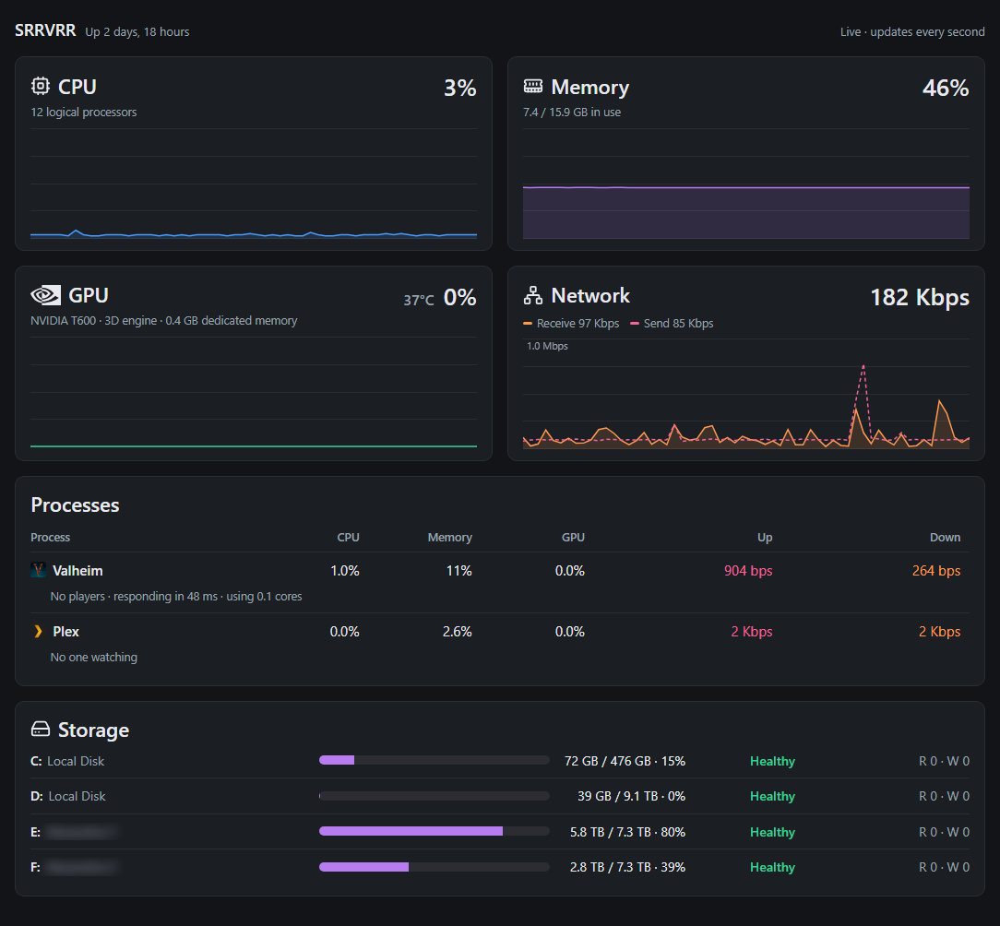

# SRRVRR



*A live SRRVRR dashboard. Private share names are blurred.*

A tiny live CPU / memory / GPU / network dashboard for Windows, in the spirit of
Task Manager's Performance tab. Run it on one machine and watch it from any
browser on your network.

One PowerShell script. Nothing to install.

Current version: **0.6.0**. See the [changelog](CHANGELOG.md) for what changed in each version.

## Contents

- [What it shows](#what-it-shows)
- [Requirements](#requirements)
- [Quick start](#quick-start)
- [Settings](#settings)
  - [Data folder and logs](#data-folder-and-logs)
  - [Upgrading from an older version](#upgrading-from-an-older-version)
  - [CPU and memory temperatures](#cpu-and-memory-temperatures)
  - [Command-line override](#command-line-override)
  - [Firewall rules](#firewall-rules)
- [Security warning: public IP addresses](#security-warning-public-ip-addresses)
  - [Disclaimer and limitation of liability](#disclaimer-and-limitation-of-liability)
- [Processes table](#processes-table)
- [Alerts](#alerts)
- [Administrator vs. not](#administrator-vs-not)
- [Troubleshooting](#troubleshooting)
- [How it works](#how-it-works)
- [Checks and tests](#checks-and-tests)
- [License](#license)

## What it shows

Updated every second, each with a 60-second graph:

| Card    | Details |
|---------|---------|
| CPU     | Overall utilization (the same number Task Manager shows), and the processor's name (e.g. "Intel Core i7-13700K"). The tile shows the maker's logo (Intel or AMD) |
| Memory  | % used and GB used / total, and the memory's maker and type (e.g. "G.Skill DDR5"; "Mixed" when sticks come from different makers). The tile shows the maker's logo for Samsung, SK hynix, Micron (and its Crucial brand), Kingston, Corsair, G.Skill and ADATA. Hover for each stick's slot, part number, size and the speed it runs at now |
| GPU     | Busiest engine (e.g. 3D, video decode) of one chosen GPU, plus its dedicated memory in use. The tile shows the card maker's logo (NVIDIA, AMD or Intel) |
| Network | Receive and send rates across all adapters |

Below the graphs, a **Processes** table shows CPU, memory, GPU and network up/down for
specific programs (a Valheim dedicated server and Plex), or "Offline" when they aren't running.

A **Storage** card lists every local drive (1 GB or larger) with a usage bar, used/total space and
the health Windows reports for the disk it's on (Healthy / Warning / Unhealthy, from the drive's
own SMART self-monitoring). Bars turn amber at 85% full and red at 95%. Drives are re-checked
every 30 seconds on a separate background thread, so the once-a-second graphs never stall. The
last column shows each drive's live read and write speed in fixed-width cells, in bytes per second
scaled from B/s to GB/s, updated every second from Windows' per-drive disk counters. Each value is
colored by how close it is to the drive's maximum speed: amber at 70%, red at 90%. Windows doesn't
report a drive's maximum, so SRRVRR uses the typical ceiling for its connection and media type
(NVMe SSD ~3,500 MB/s, SATA SSD ~550 MB/s, hard drive ~200 MB/s, USB ~400 MB/s, otherwise
~500 MB/s), raised to the fastest speed actually seen on that drive if it ever goes faster.

The header shows how long the server has been up (e.g. "Up 3 days, 4 hours") and an amber
**Restart pending** badge when Windows has installed updates that are waiting for a restart
(checked every 60 seconds via the registry markers Windows Update and the servicing stack set).

For NVIDIA cards, the GPU tile also shows the card's temperature next to its usage, from
`nvidia-smi` (installed with NVIDIA's driver), updated every 5 seconds. It turns amber at 80 °C
and red at 90 °C. AMD and Intel have no built-in equivalent, so their cards show no temperature.

The CPU and Memory tiles show a temperature the same way, updated every 5 seconds, once
[temperature sensors are set up](#cpu-and-memory-temperatures):

- **CPU:** the package temperature, the overall reading the processor reports for itself (AMD
  calls it Tctl). An average across cores could hide one hot core. Amber at 80 °C, red at 90 °C;
  most current desktop processors throttle at 95–105 °C. Hover for each core.
- **Memory:** the hottest stick, read from each stick's own sensor, since one overheating stick is
  what causes errors. Amber at 70 °C, red at 80 °C; memory is specified to 85 °C. Hover for each
  stick. DDR5 sticks have a sensor; most DDR4 sticks don't, and then the tile shows a gray
  **No sensor** (hover names the sticks).

When temperatures can't be read (not set up, not running as administrator, or the sensors don't
answer), the tiles show an amber **Temp n/a**; hover for the reason.

The page follows your system's light/dark theme and works on phones.

## Requirements

- Windows 10/11 or Windows Server with Windows PowerShell 5.1 (built in), in any display language
- Any modern browser to view the page

**Language support.** Windows translates performance-counter names into its display language,
which breaks tools that look counters up by name with `Get-Counter`. SRRVRR doesn't use it: it
reads counters through .NET, which resolves the English names on every language edition of
Windows, and its other checks (drive health, firewall, registry) don't depend on the language.
The page and console text are in English. It has been tested on English Windows only; if
something doesn't show up on another language, please open an issue.

## Quick start

1. Copy these files and folders to the machine you want to watch, all in one folder:
   - `SRRVRR.ps1`, and the `modules` and `web` folders next to it
   - `Start SRRVRR.bat`
   - `SRRVRR.config.example.psd1`
   - `Install Temperature Sensors.bat` and `Install-TemperatureSensors.ps1` (optional, for CPU
     and memory temperatures)
   - `Stop SRRVRR.bat` (optional, to stop it cleanly)
2. Copy `SRRVRR.config.example.psd1` to `SRRVRR.config.psd1` and edit it
   (see [Settings](#settings)). Without it, the defaults below are used.
3. Optional: double-click `Install Temperature Sensors.bat` once (see
   [CPU and memory temperatures](#cpu-and-memory-temperatures)).
4. Double-click `Start SRRVRR.bat` and click **Yes** on the administrator prompt. Say **No** to
   run it without administrator (see [Administrator vs. not](#administrator-vs-not)).
5. Open the address the window shows, e.g. `http://<that-machine>:8099` or
   `http://<its-IP>:8099`, from any browser on your network.

Leave the window open while you want monitoring. To stop it, press Ctrl+C in the window, or
double-click **`Stop SRRVRR.bat`**, which stops the SRRVRR in its own folder (a test copy in another
folder isn't touched): it signals SRRVRR to save and close, ends it if it hasn't closed after 10 seconds,
closes its window, and says what happened. When SRRVRR was started as administrator, it asks for
administrator too, since only administrator can signal it then. It runs `SRRVRR.ps1 -Stop`, which you
can also run yourself. Closing the window is a hard stop: it skips the save, so up to 5 minutes of
history and the last log line can be lost.

### CPU and memory temperatures

Windows has no built-in way to read the processor's or memory's temperature, so SRRVRR uses two
free components, which `Install-TemperatureSensors.ps1` downloads and sets up:

- **[LibreHardwareMonitor](https://github.com/LibreHardwareMonitor/LibreHardwareMonitor)'s sensor
  library** (MPL-2.0), copied to `lib\LibreHardwareMonitor` next to `SRRVRR.ps1`. Only the
  library and the files it needs are kept, not the app.
- **The [PawnIO](https://github.com/namazso/PawnIO.Setup) driver**, signed by its author, which the library uses to
  read the sensors. It replaces the old WinRing0 driver that antivirus software flags.

Close SRRVRR, double-click **`Install Temperature Sensors.bat`**, and click **Yes** on the
administrator prompt. The window stays open at the end so you can read what happened. It runs
`Install-TemperatureSensors.ps1`, which you can also run yourself from an administrator
PowerShell window. Both downloads are pinned to one version and checked against a known
SHA-256 hash, and the PawnIO installer's signature is checked too; anything that doesn't match is
refused. At the end it reads the temperatures once, so you can see they work. Then start SRRVRR
again. Running it again is safe: it replaces the library and installs PawnIO only when it's
missing or older. To remove it all: delete the `lib` folder, and uninstall PawnIO from
**Settings > Apps**.

## Settings

All settings live in `SRRVRR.config.psd1`, next to `SRRVRR.ps1`. Restart the
monitor after changing it.

That file is listed in `.gitignore`, so it is never committed to the repository and pulling or
copying a new version of the code never overwrites it. When updating, replace
`SRRVRR.ps1`, the `modules` and `web` folders (whole: delete the old ones first, so no old file is
left behind), `Start SRRVRR.bat`, `Stop SRRVRR.bat`, `SRRVRR.config.example.psd1`,
`Install Temperature Sensors.bat` and `Install-TemperatureSensors.ps1` (the `lib` folder the
installer creates stays as it is).

| Setting | Default | Values |
|---------|---------|--------|
| `Port` | `8099` | Port the dashboard is served on. The monitor always listens on this machine's own addresses (its name, its network IP and `localhost`). |
| `FirewallScope` | `'LocalSubnet'` | The firewall rule is always set up, since other PCs can't reach the page without it. This chooses who it lets in: `'LocalSubnet'` = devices on the same local network. `'Allowlist'` = only `FirewallAddresses`. `'Blocklist'` = the local network, except `FirewallAddresses`. |
| `FirewallAddresses` | `@()` | Addresses for `Allowlist`/`Blocklist`: single IPs, ranges or subnets, e.g. `@('192.168.1.20', '192.168.1.100-192.168.1.120', '10.0.0.0/24')`. Private addresses only: `192.168.x.x`, `10.x.x.x`, `172.16-31.x.x`, `169.254.x.x`, `127.x.x.x`, IPv6 `fe80::/10` and `fc00::/7`; anything else stops the monitor with a message (but see `AllowPublicAddresses`). |
| `AllowPublicAddresses` | `$false` | **Security risk, at your own risk.** `$true` lets an `Allowlist` also contain specific public (internet) IPs, single addresses only. Read [Security warning: public IP addresses](#security-warning-public-ip-addresses) first. |
| `PreferredGpu` | `''` | The graphics card to show, by its exact name as Windows reports it (dxdiag > Display > Name, or Device Manager > Display adapters), e.g. `'NVIDIA T600'`. Not case-sensitive. `''`, or a name that isn't found, = the GPU with the most video memory. At startup the console shows the card in use and its size (e.g. `NVIDIA T600 · 4 GB`), and lists every GPU's name if `PreferredGpu` isn't found, so you can copy one. |
| `Processes` | all `$true` | One switch per built-in table row, e.g. `@{ Valheim = $true; Plex = $false }`. `$false` hides that row; the table disappears when every row is hidden. |
| `ValheimPort` | `2456` | The Valheim server's game port. Its player count is read from the status query on the next port up. |
| `DataPath` | `''` | Where SRRVRR keeps its `state` and `logs` folders. `''` = SRRVRR's own folder; or a full local folder path with a drive letter, e.g. `'D:\SRRVRR'`. See [Data folder and logs](#data-folder-and-logs). |
| `LogRetentionDays` | `31` | How many days of logs to keep, 7 to 366. |
| `MaintenanceHours` | `2` | How long the Maintenance checkbox stays on, in hours (0.25 up to `MaintenanceMaxHours`). |
| `MaintenanceMaxHours` | `8` | The longest Maintenance can stay on, in hours (1 to 24). |

Example:

```powershell
@{
    Port              = 8099
    FirewallScope     = 'LocalSubnet'
    FirewallAddresses = @()
    PreferredGpu      = 'NVIDIA T600'
    Processes         = @{ Valheim = $true; Plex = $true }
}
```

`SRRVRR.config.example.psd1` has the same settings with comments explaining each one.
Unknown settings are ignored with a warning; an invalid setting stops the monitor with one message
saying what's allowed (exit code 2).

### Data folder and logs

SRRVRR keeps its data in two folders under `DataPath` (by default its own folder): `state` and `logs`.
It creates those two, never `DataPath` itself.

- **The log**, `logs\srrvrr-YYYY-MM-DD.log`, one file per day: every startup step, settings problems,
  errors from the background readers (each written when it appears or changes, and at most once a
  minute), crashes with their details, and a last line saying why SRRVRR stopped, e.g.
  `stopped: requested (exit 0)`. Each day's file stops growing at 20 MB. Removing files older than
  `LogRetentionDays` comes with the event log in a later release; until then old files stay.
- **If `DataPath` is missing or can't be written**, at start or later, SRRVRR uses its own folder until
  the next restart and logs a flag saying so. The Storage card keeps watching the drive that holds
  `DataPath`, even a USB drive, and shows it as Missing when it's gone.
- **It refuses to start** (exit code 3) if the data folder is shared on the network, is on a network
  drive, or is already used by another copy of SRRVRR. That includes a folder on a drive you share as
  a whole (a share of `E:\` covers everything on E:), and a drive root with a shared folder below it.
  Windows' own hidden drive shares (`C$` and the like) don't count. Pick a folder no share covers.
- **When run as administrator**, it makes sure only SYSTEM and Administrators can change `state` and
  `logs`; everyone who could read them before still can.

Exit codes, for anything that starts SRRVRR: 0 a clean stop, 2 a settings error, 3 a refusal to start,
anything else a crash.

### Upgrading from an older version

**Renamed from System Monitor to SRRVRR.** The files are now `SRRVRR.ps1`, `Start SRRVRR.bat` and
`SRRVRR.config.example.psd1`, and the firewall rules are named "SRRVRR". On first start the old
"System Monitor" firewall rules are removed automatically, and an existing
`SystemMonitor.config.psd1` is still read (with a note to rename it to `SRRVRR.config.psd1`).

`ListenAddress`, `OpenFirewall` and `GpuFallback` are no longer used: the monitor always listens
on this machine's own addresses, always sets up the firewall rule, and falls back to the GPU with
the most video memory. An old config still works; the monitor just notes that those settings can
be deleted. `PreferredGpu` now needs the card's full name (e.g. `'NVIDIA T600'` rather than
`'T600'`); if it doesn't match, the startup message lists the names to choose from.

### Command-line override

```powershell
.\SRRVRR.ps1 [-Port <number>]
```

`-Port` overrides the config file for that run.

### Firewall rules

The rules are rebuilt on every start to match the current settings:

- `LocalSubnet`, `Allowlist`: one Allow rule, "SRRVRR".
- `Blocklist`: an Allow rule for the local network plus a Block rule, "SRRVRR (blocked)",
  for `FirewallAddresses` (Windows applies Block rules first).

The page has no password, so it is deliberately limited to local networks: every scope only
admits local-network addresses, unless you opt in to `AllowPublicAddresses` (below). To remove
the rules:

```powershell
Remove-NetFirewallRule -DisplayName 'SRRVRR', 'SRRVRR (blocked)'
```

## Security warning: public IP addresses

> **USE AT YOUR OWN RISK.** Setting `AllowPublicAddresses = $true` and listing public IPs in an
> `Allowlist` exposes this monitor to the internet. Do this only if you understand and accept
> the risks below.

SRRVRR was built for trusted home and office networks. It was **not** designed or
security-tested for the internet. If you allow public IP addresses:

- **No password.** Anyone who connects from an allowed IP sees the page. There is no login.
- **No encryption.** The page is served over plain HTTP. Anything between you and the server
  (public Wi-Fi, your mobile carrier, ISPs along the way) can read it.
- **IP addresses are a weak lock.** Many people can share one public IP (mobile carriers,
  hotels, offices, carrier-grade NAT), and home IPs change: the address you allowed today may
  belong to a stranger tomorrow.
- **It reveals information.** Your computer's name, which programs are running (e.g. your game
  or media server), and patterns of activity, such as when you're streaming, playing, or away.
- **More attack surface.** Opening a port means internet scanners will find it. Any flaw in this
  script, PowerShell, or Windows' web server component (`HttpListener`/`http.sys`) becomes
  reachable from the internet.
- **You must also forward the port on your router.** That is a change you make outside this
  tool, and it is your responsibility to undo it.

Safeguards in this tool: public addresses are refused unless you opt in, only in an
`Allowlist`, only as **single** IPs (no ranges, subnets or "any"), and every start prints a
warning listing the public IPs that are let in.

Found a security problem? Please report it privately, as described in the
[security policy](SECURITY.md), rather than in a public issue.

**Safer alternative:** use a VPN to reach your home network instead of opening a port, or your
router's built-in VPN. The page then stays on your local network.

### Disclaimer and limitation of liability

This software is provided **"as is"**, without warranty of any kind, express or implied,
including but not limited to the warranties of merchantability, fitness for a particular purpose
and non-infringement. In no event shall the authors or copyright holders be liable for any
claim, damages or other liability, whether in an action of contract, tort or otherwise, arising
from, out of or in connection with the software or the use or other dealings in the software,
including, without limitation, any exposure of your systems or information resulting from
enabling `AllowPublicAddresses`, opening firewall ports, or forwarding ports on your router.
**By enabling `AllowPublicAddresses`, you accept full responsibility for the consequences.**

## Processes table

Each row adds up every process matching that program, including helpers (for Plex: Plex
Transcoder and friends). Numbers are calculated the way Task Manager does: CPU is a share of all
cores, memory is private working set as a share of total RAM, and GPU is the busiest engine on
the chosen GPU. Per-process network comes from Windows' kernel network events (the same source
Resource Monitor uses) and needs the monitor to run as administrator; otherwise it shows "n/a".

The built-in rows are Valheim (`valheim_server.exe`) and Plex (`Plex Media Server.exe`); hide
either with the `Processes` setting.

Under each running process, a quiet detail line says what it's doing:

- **Plex:** active streams and how many are transcoding (re-encoding on the fly, which is what
  loads the GPU) versus direct play, e.g. "2 streams · 1 transcoding". Hover for who is watching
  what, on which device, and how it's played. Read every 10 seconds from Plex's local API (`/status/sessions`). The Plex token is read
  from Plex's own settings in the registry of the account Plex runs under; it is never stored in
  the config, printed, or sent to the page. If Plex isn't running yet (for example, it starts
  after SRRVRR at boot), SRRVRR looks again every minute until it finds the token.
- **Valheim:** players online, how fast the server answers its status query, and its CPU use in
  whole cores, e.g. "3 players · responding in 4 ms · using 0.9 cores". Hover for player names and
  how long each has been on. Read every 10 seconds with Valve's A2S server query (UDP, on
  `ValheimPort` + 1). Valheim answers that query from its main game loop, so a reply over 250 ms
  turns amber; and since its simulation is mostly one main thread, cores near 1.0 while players
  report lag point at that thread. Per-player ping is not part of the query. The server must run
  with `-public 1`: servers started with `-public 0` or in crossplay mode don't answer the query,
  which shows quietly as "status query off"; a server that stops
  answering after it had been shows in amber.

## Alerts

When something happens on the server, a banner slides down from the top of the page. It closes
by itself after 15 seconds on screen (alerts that arrive while the tab is in the background wait
until you come back), or click × to close it.

- **Valheim:** a player joined or left, e.g. "Ivar joined Valheim · 2 players online". Names
  appear when the server reports them; otherwise "A player joined". Checked every 10 seconds,
  with the player count.
- **Plex:** a stream started, with what's playing, who, on which device, and how: e.g.
  "Plex: The Office - Dinner Party · Alex on Living Room TV (Plex for Roku) · Transcoding
  1080p → 720p on the GPU · 4.0 Mbps", or "Direct play · 1080p". Transcoding on the CPU instead
  of the GPU is worth noticing: it's what makes a server struggle. Pausing and resuming doesn't
  count as a new stream.

**Sound:** click **Sound off** in the header to turn on a soft ding with each alert (you hear a
sample). Browsers only play sound after you've clicked or tapped the page, so after a reload the
button says "Sound on: tap to allow" until you click or tap anywhere on the page. The choice is remembered in each
browser.

Alerts come from the open page, so they appear (and ding) in every browser that has the
dashboard open, and in none when no one has it open. What was already going on when the page
opens never pops up. Browsers check less often in background tabs, so an alert there can be up
to a minute late.

## Administrator vs. not

- **As administrator:** the page is reachable from other devices on your network, the firewall
  rule is managed, and per-process network and CPU/memory temperatures work.
- **Not as administrator:** it still runs, but only `http://localhost:<port>` on that machine
  works, per-process network shows "n/a", and the CPU and memory temperatures show "Temp n/a".

## Troubleshooting

- **Another PC gets "Bad Request - Invalid Hostname" (HTTP 400):** SRRVRR is running without
  administrator (its window says "Loading without Admin Privs..."), so Windows only lets it
  answer on that machine. Close it and start it again, clicking **Yes** on the prompt.
- **Page won't load from another PC:** make sure it was started as administrator, and check the
  firewall rule: `Get-NetFirewallRule -DisplayName 'SRRVRR'`.
- **"The process cannot access the file because it is being used by another process":**
  something else is using the port. Pick another `Port`.
- **GPU tile says "... not found, showing ...":** `PreferredGpu` doesn't exactly match any card's
  name. The startup message lists the names Windows reports; copy one into the config.
- **GPU shows N/A:** the machine has no GPU performance counters (e.g. no GPU or a basic display driver).
- **CPU or memory shows "Temp n/a":** hover it for the reason. "Not set up" or "the PawnIO driver
  is missing": run `Install Temperature Sensors.bat`. "Needs administrator": start SRRVRR as
  administrator. A gray "No sensor" on the Memory tile means the sticks have no
  temperature sensor (most DDR4); nothing is wrong.
- **Script won't run (execution policy):** use the `.bat` launcher, or run
  `powershell -ExecutionPolicy Bypass -File .\SRRVRR.ps1`.

## How it works

A background loop reads Windows performance counters once per second
(`Processor Information`, `Memory`, `Network Interface`, `GPU Engine`, `GPU Adapter Memory`,
`Process`) and keeps the latest values in memory. A small built-in web server (`HttpListener`)
serves the dashboard page at `/` and the latest readings as JSON at `/stats`, which the page polls.
`/stats` also reports `tickMs`, the time each reading takes, so SRRVRR's own cost stays visible.

The code is `SRRVRR.ps1` plus modules in `modules\` (the counter math, settings, and the web server's
request handling), always loaded from SRRVRR's own folder, never by name. The page is plain files in
`web\` (`index.html`, `app.js`, `style.css`, and the logos in `img\`), read from disk on every request, so
a change to the page shows with a browser refresh. The web server answers only requests addressed to
this machine's own names and addresses, serves only those page files, and answers anything else with
an error.
The GPU is picked through Windows' DirectX adapter list in the registry (the same names dxdiag
shows), which uses the same adapter IDs as the GPU counters and also gives the card's vendor ID
for the logo: NVIDIA (`10DE`), AMD (`1002`/`1022`) or Intel (`8086`); anything else gets a
plain GPU icon.

The processor's name and maker come from Windows (`Win32_Processor`), with the trademark marks and
clock speed left out. Each memory stick's maker, type and speed come from `Win32_PhysicalMemory`.
Windows reports the maker as a name ("G Skill Intl"), as a raw JEDEC ID code (e.g. `04CD`), or
not at all, so SRRVRR recognizes all three, falling back to the part number's prefix (e.g.
`F5-` for G.Skill). Both are read once at startup.

Logos and icons ship with SRRVRR (in `web\`), so the page needs no internet access: Valheim emblem
(valheimgame.com), Plex chevron (Plex Media Server), NVIDIA eye mark (nvidia.com), AMD arrow
(amd.com), Intel wordmark (Intel's 2020 logo), memory makers' logos (Samsung, Kingston and
Corsair from [Simple Icons](https://simpleicons.org), CC0; SK hynix, Micron and ADATA from
Wikimedia Commons, public domain; G.Skill from gskill.com), shown in one color to match the
theme, and CPU/RAM/network/GPU/bell icons from
[Lucide](https://lucide.dev) (ISC license). The alert ding is generated by the browser (a fading
880 Hz tone through the Web Audio API), so there's no sound file either.

## Checks and tests

For anyone changing SRRVRR. `tools\Invoke-Checks.ps1` runs every check, the same way on your machine and
on GitHub: a parse of every script (and a compile of the C# inside it, as Windows PowerShell 5.1 does),
an ASCII check, a scan for private details, PSScriptAnalyzer, and the Pester tests in `tests\`. It needs
Pester 6.2.0 and PSScriptAnalyzer 1.25.0 for your account:

```powershell
Install-Module Pester -RequiredVersion 6.2.0 -Scope CurrentUser -Force -SkipPublisherCheck
Install-Module PSScriptAnalyzer -RequiredVersion 1.25.0 -Scope CurrentUser -Force
.\tools\Invoke-Checks.ps1          # add -Smoke to also start real test copies
```

To try a branch without touching a running SRRVRR, build a test copy in its own folder and start it there
(it listens on port 8091): `.\tools\New-TestBuild.ps1 -Ref <branch> -Destination <folder>`. Then
`.\tools\Measure-SRRVRR.ps1 -Folder <folder>` measures its CPU, memory and response times against the
budgets in `tools\budgets.psd1`. None of `tests\`, `tools\` or `docs\` is part of a release.

## License

Copyright 2026 nscarritt. Licensed under the
[PolyForm Noncommercial License 1.0.0](LICENSE)
([official text](https://polyformproject.org/licenses/noncommercial/1.0.0)).

In short (the license text is what counts):

- **Noncommercial use only.** Personal use, hobby projects, research and use by charities,
  schools and public bodies are allowed. Commercial use is not.
- You may share it and changes you make, for noncommercial purposes, keeping the license and the
  `Required Notice` line with it.
- No warranty and no liability; see also the
  [Disclaimer and limitation of liability](#disclaimer-and-limitation-of-liability) above.

Versions 0.1.0 to 0.3.0 were released under the MIT License; copies obtained under those
releases keep their MIT terms. This license applies from the next version on.

Valheim, Plex, NVIDIA, AMD, Intel, Samsung, SK hynix, Micron, Kingston, Corsair, G.Skill and
ADATA logos are trademarks of their respective owners and are
used only to identify those products; they are not covered by this license. The CPU, memory,
network, GPU, storage and bell icons are from [Lucide](https://lucide.dev) (ISC license).
`Install-TemperatureSensors.ps1` downloads LibreHardwareMonitor's library (MPL-2.0) and the
PawnIO driver from their own GitHub releases; neither is part of this repository.
